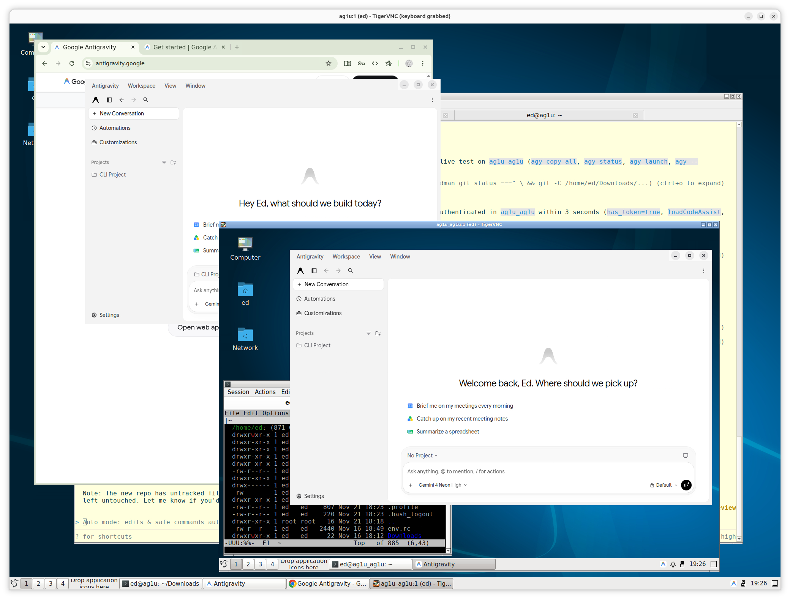

# Google Antigravity image (`d_distro=antigravity`)

[Google Antigravity](https://antigravity.google), Google's agentic coding platform: the
desktop App, its Python SDK, and an installer for its CLI (`agy`). It runs on Ubuntu's
`lxqt` stage (LXQt, Google Chrome, TigerVNC/noVNC, nested podman, `install_claude`). One
stage, `lxqt`, tagged `u2604antigravity:lxqt`. It builds on amd64 and arm64: Google
publishes the App, the CLI and the SDK's wheels for both, and it runs on an arm64 DGX
Spark as well as on amd64.



```bash
source ./env.rc
d_distro=antigravity d_target=lxqt d_build              # builds u2604cc:lxqt first
d_select 1; d_distro=antigravity d_target=lxqt d_run    # instance ag1u
d_distro=antigravity d_vnc                              # VNC 7201 (needs vncviewer)
d_distro=antigravity d_novnc                            # or noVNC on 6381, in a browser
```

Keep `d_target=lxqt` on the `d_run` line: a variable set for the `d_build` command
doesn't stay set in your shell, and `xfce` (the default) isn't an Antigravity stage.

| Distro      | Container name | Home                       | VNC    | noVNC  |
|-------------|----------------|----------------------------|--------|--------|
| antigravity | `agNu`         | `$d_dir/u2604antigravityN` | 7200+N | 6380+N |

Nested (from inside an instance) it is `<this instance>_agNu`.

## What's in it

- **Antigravity App** (the agent "command center"): in the menu under Development, or
  run `antigravity`. It is an Electron app from Google's Linux tarball, unpacked in
  `/opt/Antigravity`. `/usr/local/bin/antigravity` is a wrapper that adds:
  - `--no-sandbox`: Chromium's sandbox needs user namespaces or a setuid helper, and
    neither works in a rootless container (the same as Chrome's wrapper).
  - `--password-store=basic`: secrets such as the Google sign-in are stored in a file
    under `~/.config`, not a keyring. LXQt has no keyring daemon, and the user has no
    password to unlock one.

  Sign-in opens Google Chrome in the instance.
- **`install_agy`**: installs the Antigravity CLI with Google's installer
  (`https://antigravity.google/cli/install.sh`) into `~/.local/bin/agy`, on the home
  volume, where it updates itself, like `install_claude`. Run it once per home, as
  the user. Arguments go to the installer (`--dir PATH`).
- **Python SDK** ([antigravity-sdk-python](https://github.com/google-antigravity/antigravity-sdk-python)):
  `google-antigravity` from PyPI, whose wheels carry the compiled runtime the SDK runs
  (cloning the repository isn't enough). It is in a virtual environment, `/opt/venv`,
  first on the PATH, so `python3` finds it:
  ```bash
  export GEMINI_API_KEY=…     # or Vertex AI: see the SDK's README
  python3 -c 'from google.antigravity import Agent, LocalAgentConfig'
  ```
  Examples are in the repository's `examples/`, and a skill for coding agents in
  `skills/google-antigravity-sdk` (not part of the wheel: copy it to
  `~/.claude/skills` if you want it). The venv and `uv` (`/opt/uv/bin`) belong to
  the user, so `uv pip install -U google-antigravity` or other packages need no root;
  they are lost when the instance is replaced (the venv is in the image, not the home).

## Updating

- **App**: the image has the newest release at build time. Its own updater can't
  write to `/opt`: rebuild with `d_distro=antigravity d_target=lxqt d_build_fresh`.
  To pin a version: `d_distro=antigravity d_target=lxqt d_build --build-arg
  ANTIGRAVITY_VERSION=2.34.0` (a version from
  `https://antigravity-hub-auto-updater-974169037036.us-central1.run.app/releases`),
  or `--build-arg ANTIGRAVITY_TGZ=<url>` for a given tarball.
- **CLI**: updates itself in `~/.local/bin`.
- **SDK**: `uv pip install -U google-antigravity` for this instance, or rebuild;
  `--build-arg ANTIGRAVITY_SDK_VERSION=…` pins it.

The Antigravity IDE (the standalone VS Code-based editor) is not included.
