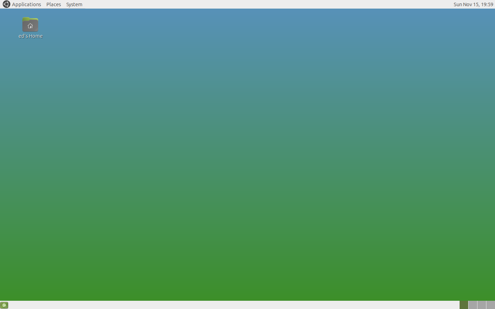

# Desktops

Each stage's desktop as it first comes up: a new home dir, nothing opened,
1440x900 (`VNC_RESOLUTION`). See [Stages](../README.md#stages) for what each one
contains.

`base` is headless, so it has no screenshot. `chrome` starts with the same
bare `xterm` as `vnc`. Ubuntu's stages first, then [Debian's](#debian).

# Ubuntu

## `vnc` (and `chrome`): xterm

## `xfce`: XFCE

## `lxqt`: LXQt

## `gnome`: GNOME Flashback

## `kde`: KDE Plasma

## `mate`: MATE

## `cinnamon`: Cinnamon

# Debian

## `vnc` (and `chrome`): xterm

## `gnome`: GNOME Shell
It starts in the Activities overview, as GNOME does.

## Retaking them

`d_screenshots N` (from `env.rc`) retakes them all for `$d_distro`
(`d_distro=debian d_screenshots N` for Debian's); `d_screenshots N kde` just
that one. For each stage it builds the image, runs it on instance N with a new
home, waits for the desktop to settle, runs `tests/screenshot.sh` inside and
saves the result as `docs/<distro>/<stage>.png`, then removes the container and that
home. N must be an unused instance number. The `vnc` stage has no screenshot
tool, so `scrot` is installed in its throwaway container for the picture.
