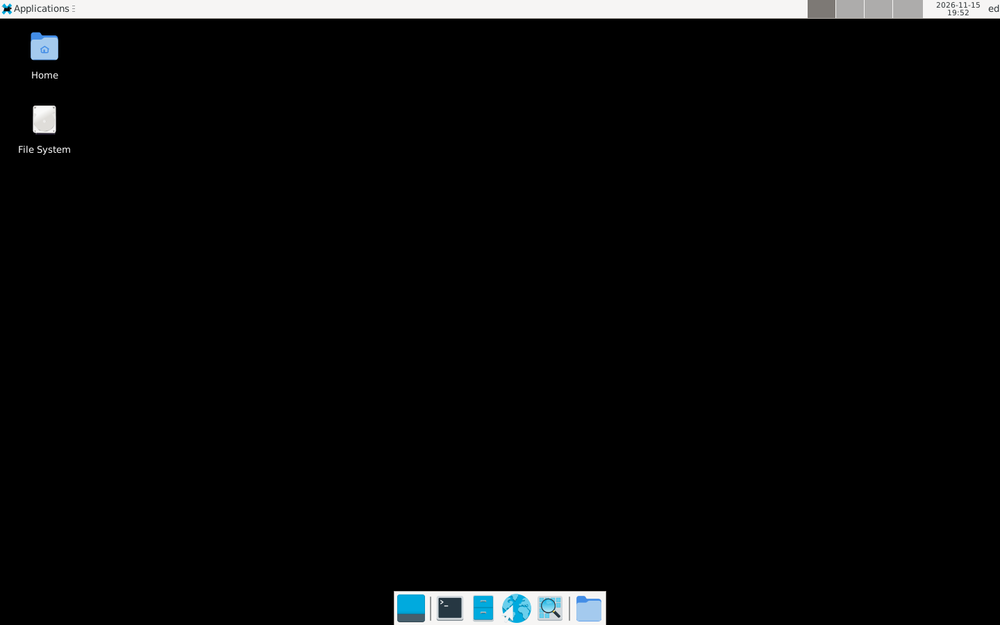
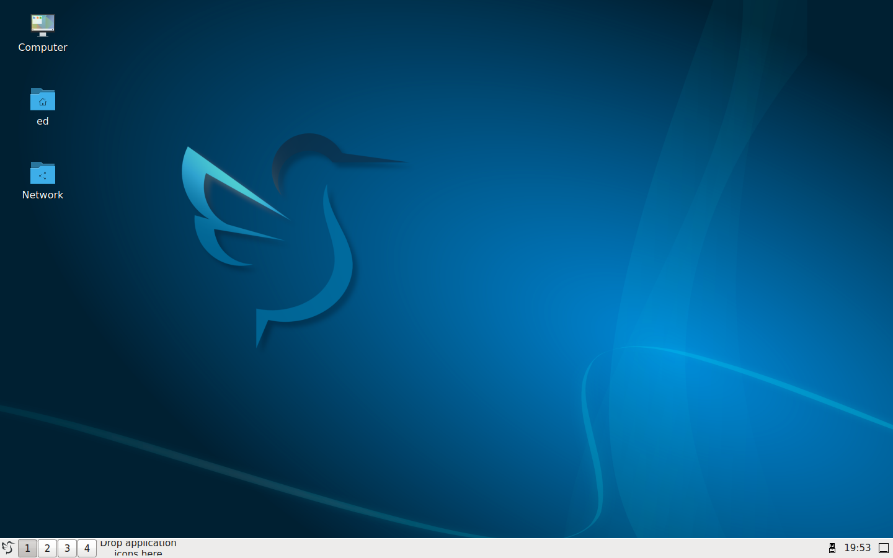
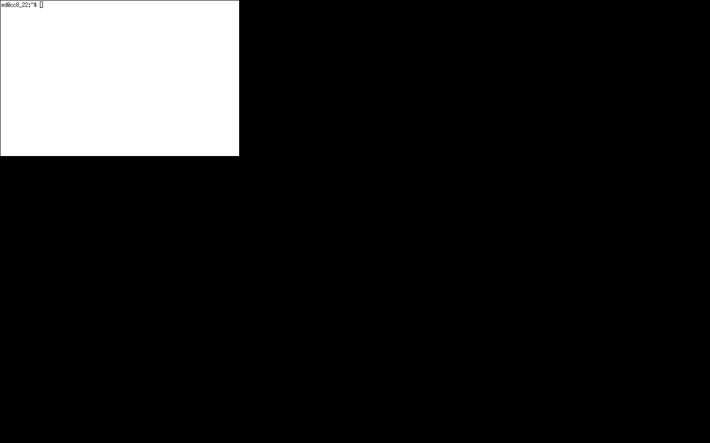
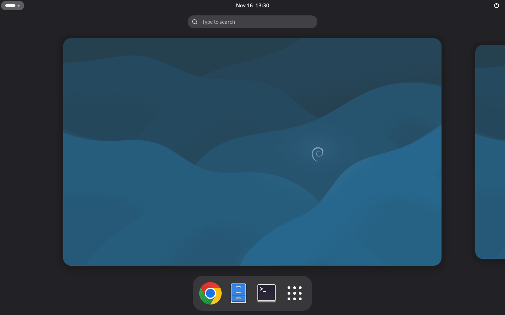
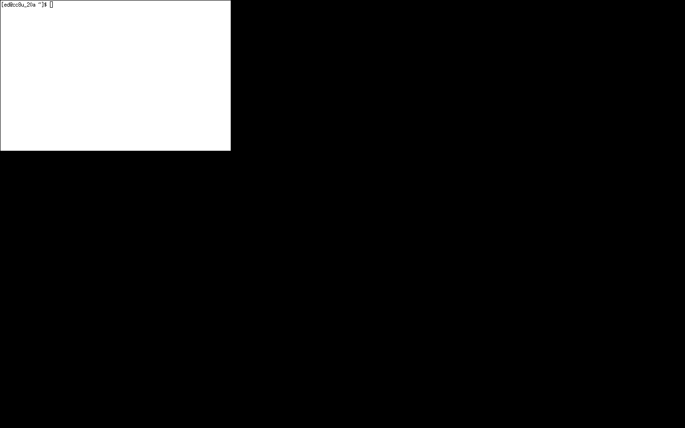
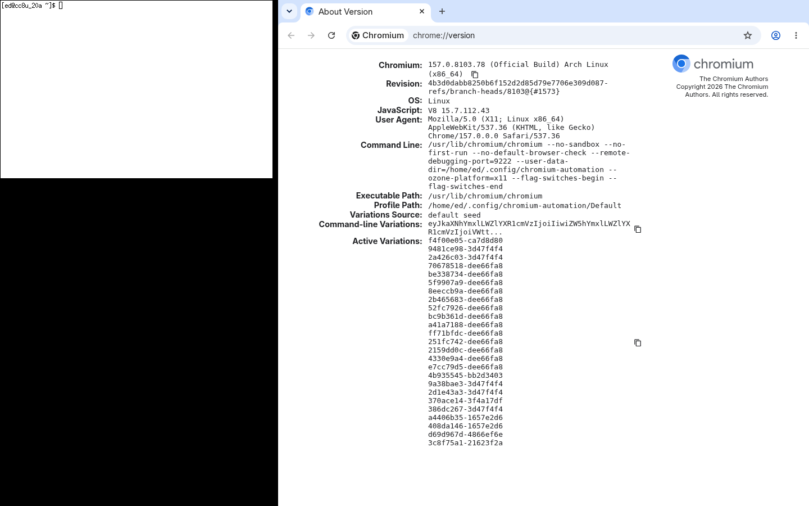
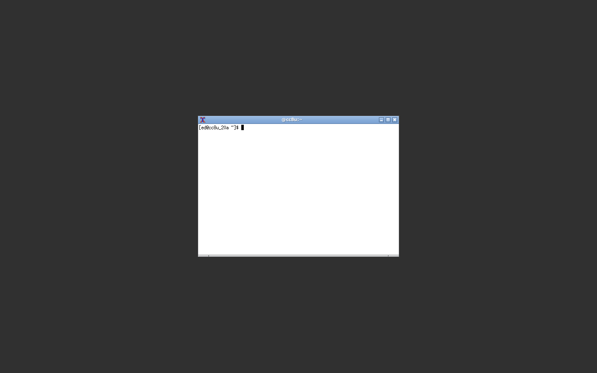

# Desktops

Each stage's desktop as it first comes up: a new home dir, nothing opened,
1440x900 (`VNC_RESOLUTION`). See [Stages](../README.md#stages) for what each one
contains.

`base` is headless, so it has no screenshot. `chrome` (Arch Linux: `chromium`) starts with the same
bare `xterm` as `vnc`. Ubuntu's stages first, then [Debian's](#debian),
[Arch Linux's](#arch-linux) and [Google Antigravity](#google-antigravity).

# Ubuntu

## `vnc` (and `chrome`): xterm

## `xfce`: XFCE

## `lxqt`: LXQt

## `gnome`: GNOME Flashback

## `kde`: KDE Plasma

## `mate`: MATE

## `cinnamon`: Cinnamon

# Debian

## `vnc` (and `chrome`): xterm

## `gnome`: GNOME Shell
It starts in the Activities overview, as GNOME does.

# Arch Linux

## `vnc` (and `chromium`): xterm

## `chromium`: Chromium
The stage comes up like `vnc`; this is after `d_chrome_bin=chromium d_chrome`, which
opens `chrome://version/`. There is no window manager in this stage, so the
window was moved next to the xterm with `xdotool` for the picture.

## `openbox`: Openbox
One xterm; the menu (Terminal, Chromium, window list, Exit) is a right-click on the background.

# Google Antigravity

## `lxqt`: Antigravity App, nested
Not a fresh home: an `ag1u` instance on an arm64 machine (DGX Spark), seen in
TigerVNC, with the Antigravity App signed in, Chrome on antigravity.google, and a
nested instance `ag1u_ag1u` (started inside `ag1u` with `d_run`) in its own TigerVNC
window, running the App too. See [antigravity/README.md](../antigravity/README.md).

## Retaking them

`d_screenshots N` (from `env.rc`) retakes them all for `$d_distro`
(`d_distro=debian d_screenshots N` for Debian's, `d_distro=archlinux` for Arch
Linux's); `d_screenshots N kde` just
that one. For each stage it builds the image, runs it on instance N with a new
home, waits for the desktop to settle, runs `tests/screenshot.sh` inside and
saves the result as `docs/<distro>/<stage>.png`, then removes the container and that
home. N must be an unused instance number. The `vnc` stage has no screenshot
tool, so `scrot` is installed in its throwaway container for the picture.
`archlinux/chromium.png` and `antigravity/lxqt-nested.png` aren't among these (they
show started apps, not the stage as it comes up): they were taken by hand, as
described above.
